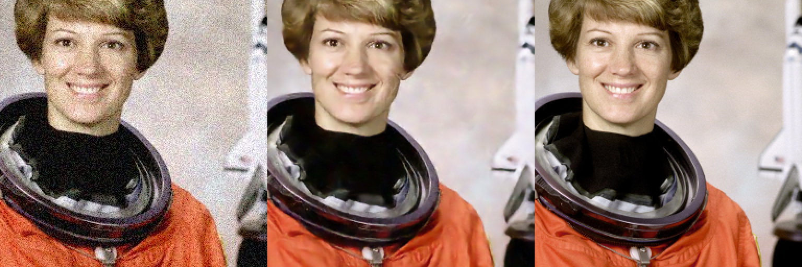

# NeuroCam enhancement model: evaluation

Held-out photos (24 unseen flower photos + 4 standard test images), synthetic camera degradation (signal dependent luma+chroma noise in linear light, then JPEG). PSNR vs. clean original, higher is better. Model run exactly like in the app (TFLite FP16, 256px tiles, 24px margin).

| Noise level | Degraded input | Bilateral filter (classic) | **NeuroCam AI** |
|---|---|---|---|
| low noise (ISO~100) | 30.49 dB | 27.96 dB | **32.26 dB** |
| medium (ISO~800) | 26.23 dB | 27.30 dB | **30.98 dB** |
| high (ISO~3200) | 23.18 dB | 25.66 dB | **29.46 dB** |

On already clean input the model output stays at 34.4 dB PSNR from the input (i.e. it does not damage clean photos).

Left: degraded input (ISO~3200-like noise + JPEG), middle: NeuroCam AI, right: original.
